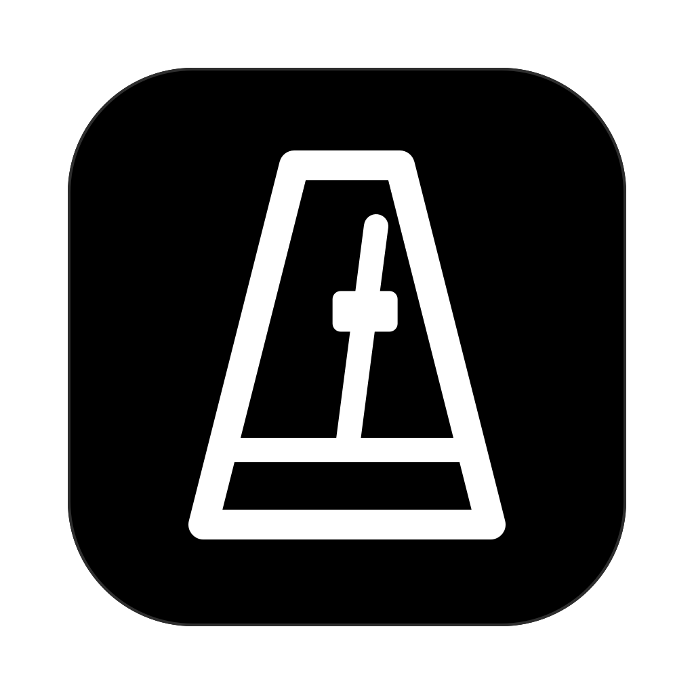
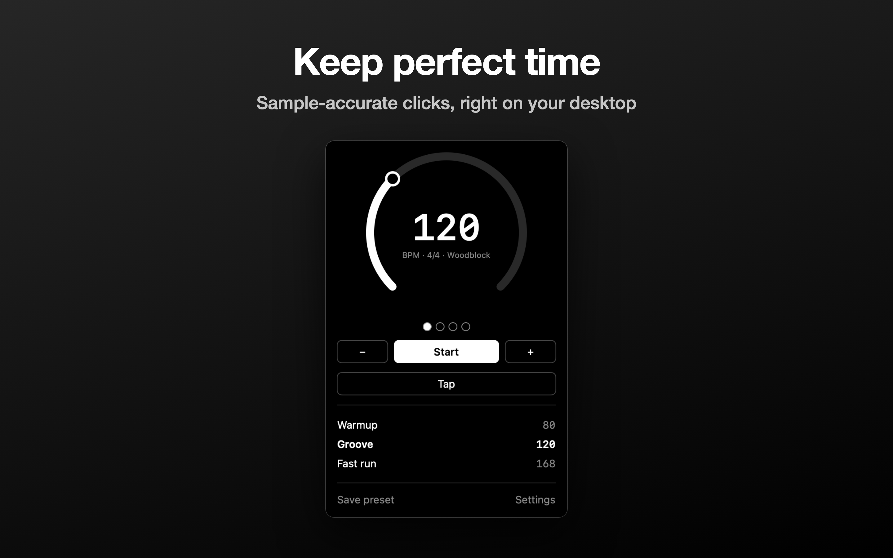
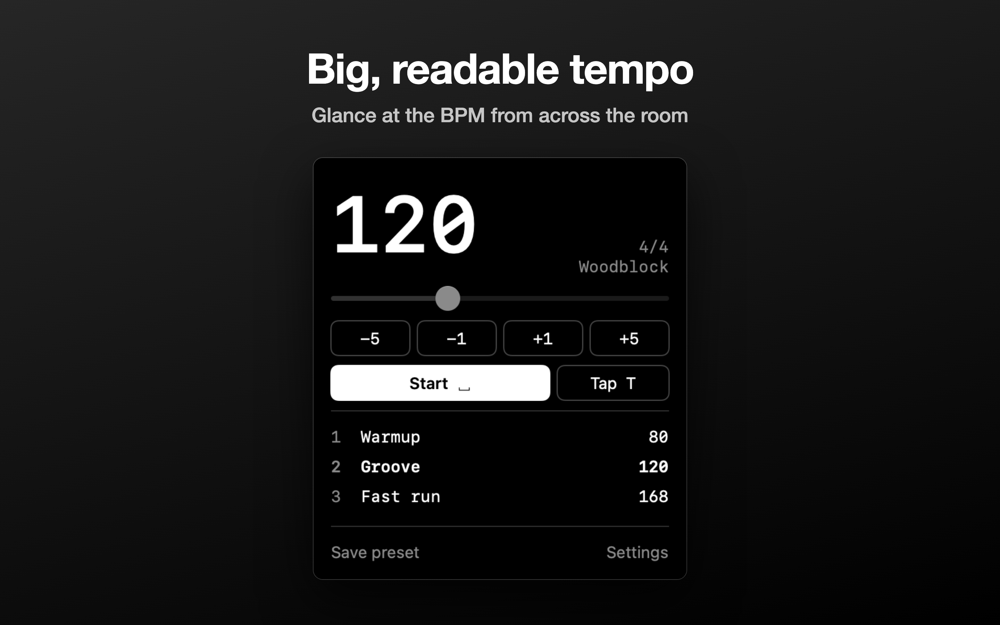
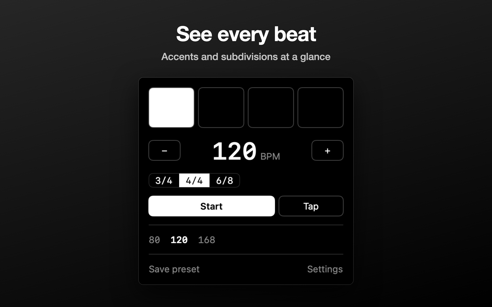
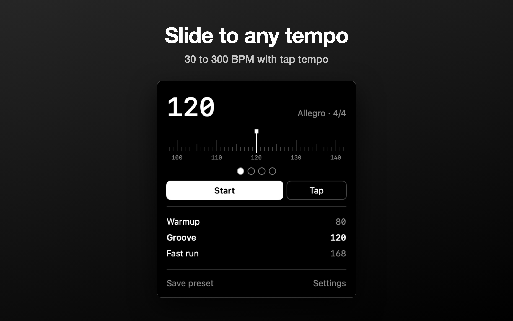
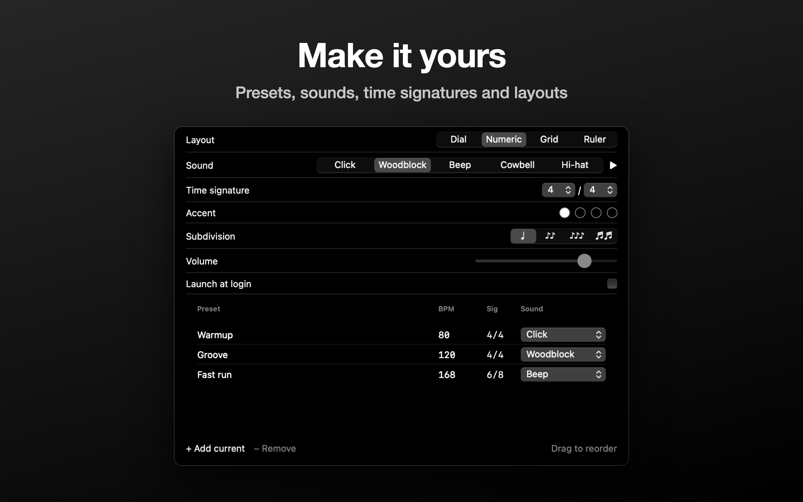

<p align="center">
  
</p>

<h1 align="center">Metronome</h1>

<p align="center">
  A precise, keyboard-friendly metronome for macOS 14+.<br>
  <a href="../../releases/latest">Download the latest release</a>
</p>

<p align="center">
  
  
  
  
  
</p>

## Features

- Four layouts: Dial, Numeric, Grid, and Ruler
- Tap tempo, 30–300 BPM
- Time signatures, per-beat accents, and subdivisions
- Five synthesised sounds with sample-accurate timing
- Presets with keyboard shortcuts, reordering, and undo
- Launch at login; settings and presets persist between launches

## Install

Download the DMG from [Releases](https://github.com/wezzcoetzee/metronome/releases) and drag Metronome to Applications.

The app is not notarized, so the first launch shows "Apple could not verify Metronome". Click Done, then open System Settings, Privacy & Security, and click Open Anyway next to Metronome. Or clear the quarantine flag:

```sh
xattr -dr com.apple.quarantine /Applications/Metronome.app
```

## Use

Start and stop playback in the main window. Use Tap to set the tempo, click a beat to toggle its accent, and click a preset to load it. The main window lists the first nine presets, numbered to match their shortcuts.

Open Settings to change the layout, sound, time signature, accents, subdivision, volume, and launch-at-login preference. Settings also lets you add, edit, reorder, and remove presets; Delete removes the selected preset, and ⌘Z undoes a removal or reorder.

### Keyboard shortcuts

With the main window focused:

| Key | Action |
| --- | --- |
| Space | Start or stop |
| T | Tap tempo |
| S | Save the current tempo, time signature, subdivision, and sound as a preset (skipped when a preset already matches) |
| 1–9 | Load a preset by its position |
| ↑ or → / ↓ or ← | Increase / decrease tempo by 1 BPM |
| Shift + arrow | Increase / decrease tempo by 5 BPM |
| ⌘, | Open Settings |
| ⌘Q | Quit |

## Build and run

Requires macOS 14+ and Xcode with Swift 6. If `xcode-select -p` points to Command Line Tools, select Xcode for this shell first (adjust the path if needed):

```sh
export DEVELOPER_DIR=/Applications/Xcode.app/Contents/Developer
```

Build the app bundle and open it:

```sh
./scripts/bundle.sh 1.0.0
open build/Metronome.app
```

To make a drag-to-Applications disk image, run `./scripts/dmg.sh 1.0.0`. Both scripts require a version argument and embed it in the app bundle. The DMG script rebuilds the app and writes `build/Metronome.dmg`.

## Releases

Push a version tag such as `v1.0.0` to build the app and publish `Metronome.dmg` in a GitHub release using the [shared macOS release workflow](https://github.com/wezzcoetzee/.github/blob/main/.github/workflows/macos-release.yml). The tag without its leading `v` supplies both bundle version fields. You can also run the macOS Release workflow manually against an existing tag.

> [!NOTE]
> The app uses ad hoc signing and is not notarized, so macOS Gatekeeper may block the first launch. Right-click the app and choose Open to allow it.

## Development

| Task | Command |
| --- | --- |
| Run core tests | `swift test` |
| Regenerate `Resources/AppIcon.icns` | `swift scripts/make-icon.swift` |

To render PNGs of all four layouts and Settings:

```sh
swift build
mkdir -p /tmp/metronome-snapshots
METRONOME_SNAPSHOT=/tmp/metronome-snapshots .build/debug/Metronome
```

App Store images live in `screenshots/`: `raw/mac` holds those snapshots and `framed/mac` holds 2880×1800 marketing frames rendered from `screenshots/frame.html`.

### Project layout

- `Sources/MetronomeCore` holds models, `MetronomeStore` (the single place settings change and persist), `ClickEngine` (sample-accurate `AVAudioSourceNode` output), and `SoundSynth`.
- `Sources/Metronome` holds the SwiftUI app. Every layout is a view over the same store.
